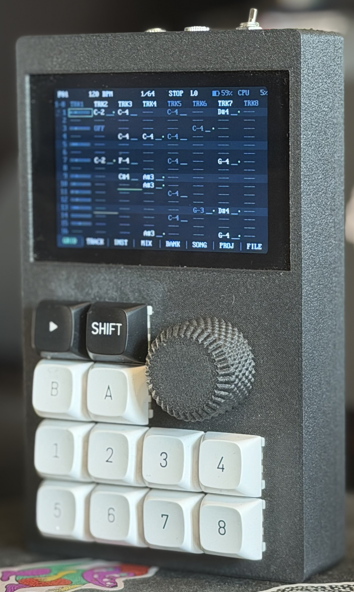

# D-TRK

<p align="center">
  <a href="docs/img/tracker.jpg"></a>
</p>

A pocket 16-track tracker with a built-in synthesizer. Built on the **WT32-SC01 Plus** (ESP32-S3, 480×320 touchscreen) plus a **Teensy 4.1** synth board: an encoder, Play, Shift, A and B buttons and 8 mechanical track buttons. With A / B the tracker works almost without the touchscreen: navigation, editing and page switching are done with the encoder and buttons. Stereo sound at 44.1 kHz through a Teensy Audio Shield (SGTL5000) to headphones. MIDI OUT (TRS) sends notes, clock and Start / Stop. The firmware is open (GPL v3), and so is the 3D-printable enclosure (CERN-OHL-S).

User manual: [docs/manual.md](docs/manual.md). Wiring: [docs/wiring.md](docs/wiring.md). Русская версия: [README_ru.md](README_ru.md).

## Features

### Sequencer

- 16 tracks, 16 patterns, 4 to 128 steps, tempo 20–300 BPM, swing.
- Each track has its own length and speed (1/4, 1/2, x1, x2, x4): polymeter, slow pads over fast grooves.
- A step holds a note, volume, chord (36 types × 4 inversions) and 6 fx commands: slide, vibrato, retrigger, arp, trig conditions (probability, fill, "previous played"…), p-locks of sound parameters, pan and LFOs.
- Fill notes, volume or any fx on every Nth step, by Euclid or at random, with value ramps.
- Generators that write straight into notes: **ARP** (106 patterns, including 64 from the Access Virus), **CHORDS** (55 progressions in the project key, 32 rhythms, RANDOM, Mutate, voice leading) and **BASS** (48 bass patterns that follow the chords). Your own patterns are saved with Capture.
- A live shift-register generator per track (**GEN**): a looping 2–16-bit register slowly mutates and plays notes of the project scale (pitch, or the rhythm too), Flip live from a track button and the FLP fx per step, Capture writes the loop into the pattern. The BYTE PITCH / BYTE GATE modes take the melody and hits from any of the 45 bytebeat formulas instead.
- **Dice** on PROJ: one roll gives a genre tempo and scale, factory sounds on four role tracks (drums, bass, chords, lead) and a pattern from the generators, undoable; **Mutate** on INST nudges an instrument's sound.
- A mutator per track (**MUT**), one mode at a time: **EVO** — the pattern drifts live (notes along the scale, drops and ghost notes, retriggers and velocity, shifted steps), pulled back by Home; **CA1D / CA2D** — every few passes a new generation of a cellular automaton grown from the pattern (1D Wolfram rules, or Life-like rules over the KIT lanes); **MARKOV** — a Markov chain built from the pattern's own notes. Capture live writes what the track plays (MUT and GEN) into the pattern.
- Grooves (MPC, shuffle, drunk, boom bap, house…) and per-track humanize.
- Scales, undo, selection, copy.
- Motion REC records parameter movements as step locks; Automation view provides value bars, ramps and parameter-only copy/paste.
- Note timing quantize with strength, live timing stored as NDG, separate note/automation clearing and temporary automation bypass.
- One- or two-bar count-in, recording/playback metronome and one-pass recording that leaves playback running.
- Microtonal project tuning: 10 factory tunings (just, meantone, 19/24/31-EDO, slendro, pelog, Bohlen-Pierce…) and your own Scala `.scl` files from the card.
- Scenes and an A↔B crossfader: 8 scenes of mix and sound locks per project, morphed live on MIX or in PERF.

### Built-in sound

32 instruments, 32 voices (up to 16 of them FM / DRUM / STRING / SYNTH WT), 44.1 kHz, stereo with per-track pan. Types:

- **FM**: 8 machines in the spirit of the Model:Cycles (kick, snare, metal, perc, tone, chord, clap, hat) with 5 macros and SAT (saturation); TONE and CHORD detuned.
- **DRUM**: 24 machines: 16 in the spirit of the TR-808 and TR-909, plus 8 more (resonant and synthetic kicks and snares, a clap with 16 patterns, a rim shot, a 2-operator FM kick, a ring-modulated hat).
- **SYNTH**: 2 oscillators (alias-free saw / square / tri or wavetable), sub, noise, hard sync. Imports WaveEdit, Serum and Vital tables; makes your own from a sample region (one pitch period or equal windows per frame) or by drawing keyframes on the touch screen.
- **STRING**: a physical-model resonator, 2 models (plucked string, 6 tuned modes for bars and bells) with Damp, Bright, Struct, Position and a click / noise-burst exciter.
- **SAMPLE**: a sampler with slices, WAV import from the card. The sample editor works without the touchscreen too. Record straight into an instrument from the mic, the line input or the tracker's own output (up to 5 min, threshold start, monitoring) while the track keeps playing. Any instrument can be rendered into a one-shot sample (Save one-shot) for a KIT lane.
- **CHIP**: pulse, triangle, noise, metal and wavetable for chiptune; C64 SID combined waves and noise, AY-3-8910
  buzzer (envelope as oscillator), noise and tone+noise, the AY 16-step volume (Step) and a SID-style filter
  (our own approximations, no emulator code or data).
- **LOFI**: bytebeat (45 built-in formulas, from the 2011 classics to our own rhythmic ones that lock to the tempo, all with A, B, C parameters) and an Atari Punk Console with subharmonics — dirty 8-bit sound.
- **KIT**: a drum track of 8 lanes, each with its own sample or any instrument.

Every instrument has a filter (LP / BP / HP, LADDER, MS20, COMB, FORMANT) with an envelope, drive and 4 LFOs (tempo sync, modulate each other, controlled from steps, a bytebeat formula as a wave). 185 factory presets.

### Mix and effects

- Mixer: faders, pan, sends, mute / solo, level meters, scope.
- Track insert: drive (TANH, CLIP, FOLD, RECT), bit crush, downsample and a trance gate with a 16-step pattern. Instrument presets carry a recommended insert.
- Envelope follower: one track's level moves a parameter of another (sidechain pumping, ducking, auto-wah).
- Sends: delay (DIGITAL, TAPE, PING-PONG), pseudo-stereo reverb with shimmer, MOD bus (chorus, ensemble, flanger, phaser).
- Master: compressor with sidechain, EQ shelves, PERF punch-in effects (repeat, roll, reverse, scratch, tape stop, gate, LP / HP filter, crush, downsample, drive, delay / reverb / MOD throw, tape wobble, freeze).
- Each track goes to the internal synth or to external MIDI.

### Live performance and song

- **Song**: up to 128 slots, each with a pattern and the mutes of 16 tracks. An A tap repeats a slot, a tap or a track button mutes a track in the slot. Follow actions per slot (next, previous, stay, jump, random, with a chance) from a project seed: every Play a new path, the render repeatable. Play on the SONG tab plays the song, on other tabs it loops the pattern; Shift + Play plays the song from the cursor on any tab; SONG / LOOP switch on the fly, undo for song edits.
- **PERF**: punch-in effects on the whole mix while a button is held (repeat, roll, reverse, scratch, tape stop, gate, filter, crush, downsample, drive, delay / reverb / MOD throw, tape wobble, freeze), the encoder sets the depth, several buttons stack; button assignment is configurable. Works on GRID, SONG and MIX; held effects also show on the whole screen (dim, pixelate, invert…), switchable in FILE → SYSTEM. XY pad (A + B): the touch screen holds two effects, the finger sets their depths.
- **REC**: record notes from the track buttons while playing.
- Shift + Play: the song from the SONG cursor on any tab; held while playing, fill.

### Files and extras

- Projects, samples and presets on microSD, autosave, templates and 8 demo songs.
- MIDI file import.
- WAV export (24 / 16-bit): a looped pattern or the whole song, the master and track stems with effect returns in one render, AUTO tail or a seamless loop; download over Wi-Fi. Resample a track into a new sample.
- Wi-Fi: a web page for firmware updates (the tracker and the synth board).
- 17 themes.

## Hardware

Two boards. The tracker is a WT32-SC01 Plus (ESP32-S3, 480×320 touchscreen): soldered to it are an EC11 encoder, a PCF8575 expander with the Play, Shift, A, B and 8 track buttons, a TRS MIDI output, LiPo power on an IP5306 and an optional INA226 battery monitor. The synth board is a Teensy 4.1 on a 3 Mbaud UART link: the synthesizer, the only microSD card, the sample bank, optional 8 MB PSRAM and a Teensy Audio Shield Rev D (SGTL5000) for the headphones.

- Architecture, link, wiring diagram, pinout and checks before power-up: [docs/wiring.md](docs/wiring.md).
- Parts list: [docs/bom.md](docs/bom.md).
- Enclosure and power circuit: [enclosure/](enclosure/README.md).

## Build and flash

You need [PlatformIO](https://platformio.org/).

```
pio run -e wt32 -t upload          # tracker (ESP32-S3): build and flash over USB
pio run -e wt32-ota -t upload      # tracker over Wi-Fi: FILE → Wi-Fi firmware… open on the tracker
pio run -e teensy41 -t upload      # synth board: first flash over the Teensy's USB (Teensy Loader)
pio run -e teensy41                # synth board .hex for the Wi-Fi page or /firmware/teensy.hex
pio test -e native                 # core tests on the computer
```

- **First flash of the Teensy** goes over its USB with Teensy Loader (before the enclosure is closed); later the synth board is updated from the tracker (Wi-Fi page or FILE → SYSTEM → Update synth).
- The ESP partition table is custom (`partitions.csv`): two ~8 MB firmware slots (`app0` / `app1`); the old `samples` partition is gone. After switching to it, flash once over USB (`pio run -e wt32 -t upload`): OTA does not change the partition table. Wi-Fi settings (NVS) are kept — `nvs` and `otadata` are at the same addresses.
- Teensy program flash: firmware from 0x60000000, OTA staging area at 0x60100000, bank (wavetables, sample starts) from 0x60200000.

Service environments:

| Env | What for |
|---|---|
| `teensy41-bench` | voice pool bench on the Teensy: results over USB serial and the link log; do not save projects from this build |
| `teensy41-desk` | desk mode: a bare Teensy on a computer, the link over USB serial, sound on USB audio; drive it with `scripts/link_desk.py hello\|notes\|status\|fs\|selftest` |
| `wt32-echo` + `teensy41-echo` | link wiring check: echo test between the boards |

## Structure

| Folder | Contents |
|---|---|
| `lib/core` | hardware-independent code shared by both boards: model, sequencer, fx, scales, tuning (`.scl` parser, factory tunings, key map), shift-register generator, evolve, variations (cellular automaton, Markov chain), song follow actions, scenes, wavetable maker, Euclid and Fill, file format, MIDI parser, synthesizer (CHIP, SAMPLE, FM, DRUM, SYNTH, LOFI: bytebeat compiler and VM, filter, delay, reverb, compressor), WAV parser, sample bank, sample store and streaming (`stream_pool`, `stream_loader`, `stream_sched`, `sample_store`, `sample_heads`, `psram_cache`), project sample list, presets; link: `link_frame`, `link_msg`, `link_fs`, `state_mirror`, `time_sync`, `bank_ops`, `render_link`, `wave_peaks`, `ihex` |
| `lib/flasherx` | FlasherX (vendored, with its license): writing the Teensy's flash for OTA |
| `src/engine` | sequencer task on core 0 (timer, MIDI output) |
| `src/link` | link client on the ESP: UART task, synth events and state, sample bank commands, synth board firmware update |
| `src/hw` | input (encoder, buttons), MIDI UART, card access, display configuration |
| `src/ui` | UI screens |
| `src/storage` | saving and loading projects and presets; `remote_fs` — the Teensy's card as an `fs::FS` |
| `src/net` | Wi-Fi, firmware web page, OTA |
| `src/teensy` | synth board firmware: link server, audio output, sample store and streaming from the card, PSRAM, bank in flash, card file server, render, preview, firmware update, bench |
| `test` | Unity tests of the core |
| `docs` | manual, wiring diagram, parts list and development plans |
| `enclosure` | enclosure: OpenSCAD model and STL |

## License

Copyright © 2026 deemonoise.

- **Firmware, tests, scripts and documentation** — [GNU GPL v3](LICENSE) (GPL-3.0-only). You may use, change and share them, sell devices with them included, as long as the source of the firmware you ship (with your changes) is published under the same license.
- **Hardware** — the enclosure ([enclosure/](enclosure/): OpenSCAD sources and STL) and the wiring diagrams ([docs/img](docs/img)) — [CERN-OHL-S v2](enclosure/LICENSE) (CERN-OHL-S-2.0): products made from them must make their modified design sources available under the same license.

The name **D-TRK** and its logo are not covered by these licenses: a modified firmware or a device built from this project may say it is based on D-TRK, but must not be called or sold as D-TRK without permission.

Full texts: [LICENSES/](LICENSES/). Third-party libraries (ESP-IDF, Arduino-ESP32, LovyanGFX, Teensyduino, Teensy Audio Library, SdFat, FlasherX, Unity) keep their own licenses.

DSP derived from MIT-licensed Eurorack firmware (`lib/core/src/synth_string.*`) — see [LICENSES/MIT-eurorack.txt](LICENSES/MIT-eurorack.txt).

The DRUM machines BDA, SDA, BDS, SDS, CPX, RSX, HHR (`lib/core/src/synth_drum2.*`) follow the algorithms of the drum voices collected in [ctag-tbd](https://github.com/ctag-fh-kiel/ctag-tbd):

- BDA, SDA, BDS, SDS, HHR — after the 2016 drum voices, MIT License, Copyright 2016 Emilie Gillet (see [LICENSES/MIT-eurorack.txt](LICENSES/MIT-eurorack.txt));
- CPX, RSX — after ctag-tbd Clap and Rimshot, © 2024 Robert Manzke, GPL-3.0.
