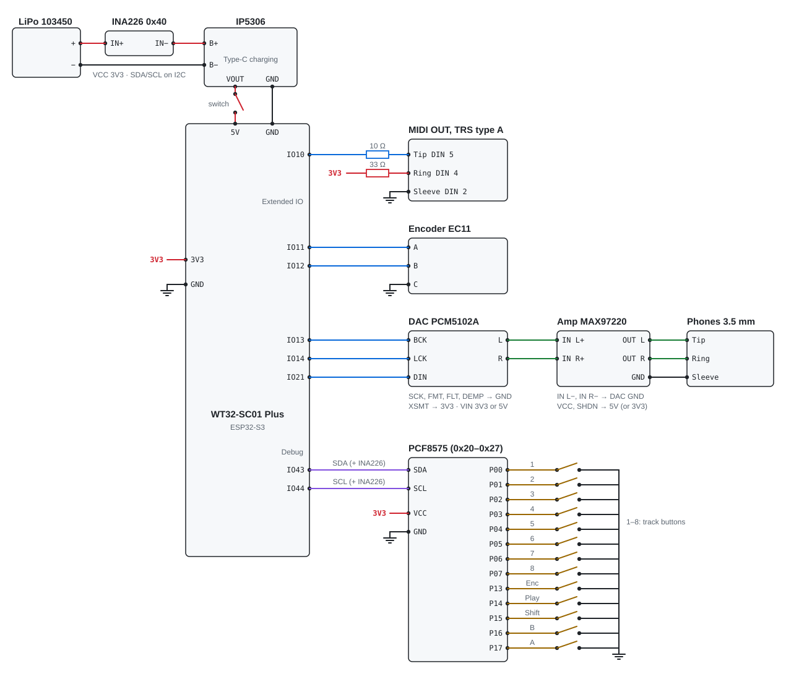

# Tracker wiring diagram

Everything you solder to the WT32-SC01 Plus: battery power, an INA226 battery monitor, MIDI OUT, the encoder, the PCF8575 expander with the encoder button, Play, Shift, A, B and eight track buttons, a PCM5102A DAC and a MAX97220 headphone amplifier. The display, touch and microSD are already routed on the board.

Русская версия: [wiring_ru.md](wiring_ru.md)

## Schematic

<a href="img/wiring.svg"></a>

```
LiPo 103450 + ── INA226 IN+ ─[shunt]─ INA226 IN− ── IP5306 B+   (IP5306 Type-C — charging)
LiPo 103450 − ──────────────────────────────────── IP5306 B−
IP5306 VOUT ──[switch]── board 5V              (VOUT/GND — pads of the desoldered USB-A)
IP5306 GND ──────────── board GND              (common ground)

WT32-SC01 Plus, expansion connector (Extended IO)
  IO10 ──[10 Ω]──── MIDI Tip     (DIN 5)
  3V3  ──[33 Ω]──── MIDI Ring    (DIN 4)
  GND  ──────────── MIDI Sleeve  (DIN 2, shield)
  IO11 ──────────── encoder A
  IO12 ──────────── encoder B         encoder C (middle) ── GND
  IO13 ──────────── DAC BCK
  IO14 ──────────── DAC LCK
  IO21 ──────────── DAC DIN

WT32-SC01 Plus, Debug connector
  IO43 TXD0 ─────── PCF SDA
  IO44 RXD0 ─────── PCF SCL
  3V3 ───────────── PCF VCC
  GND ───────────── PCF GND
  (INA226 SDA / SCL / VCC / GND — in parallel with the PCF, on the same wires)

INA226 (address 0x40–0x4F, found automatically; A0, A1 as on the module; ALE not needed)
  IN+ ── LiPo +          IN− ── IP5306 B+
  VBS ── IN+             (if broken out: battery voltage)
  VCC ── 3.3 V           GND ── GND

PCF8575 (address 0x20–0x27, found automatically; INT not needed, A0–A2 open)
  P00 … P07 ── track button 1 … 8 ── GND
  P13 ──────── encoder shaft button ── GND
  P14 ──────── Play ── GND
  P15 ──────── Shift ── GND
  P16 ──────── B ── GND
  P17 ──────── A ── GND

PCM5102A                                 MAX97220
  VIN ── 3.3 V or 5 V                      VCC ── board 5V (or 3.3V);  SHDN ── VCC
  GND ── star point ── board GND           GND ── star point
  SCK, FMT, FLT, DEMP ── GND (L)           IN L+ ── DAC L;   IN L− ── DAC GND
  XSMT ── 3.3 V (H)                        IN R+ ── DAC R;   IN R− ── DAC GND
  L / R ── line out, to the amplifier      OUT L / OUT R / GND ── jack Tip / Ring / Sleeve
```

*Every "GND" is a wire to the board's common GND; every "3.3 V" goes to the board's 3V3 pin. Encoder A and B use the board's internal pull-ups, and the PCF8575 pins have their own weak pull-ups, so the buttons and encoder need no external resistors. The PCF8575 is required: without it the encoder button, Play, Shift, A, B and the track buttons do not work.*

## Connection table

| From                              | To                                  | Notes                                                       |
|-----------------------------------|-------------------------------------|-------------------------------------------------------------|
| **Power** |                                     |                                                             |
| `LiPo + / −`                      | `IP5306 B+ / B−`                    | 103450 battery with a protection board                      |
| `IP5306 VOUT`                     | `switch → board 5V`                 | VOUT and GND are the pads of the desoldered USB-A port      |
| `IP5306 GND`                      | `board GND`                         |                                                             |
| **INA226 battery monitor** |                                     |                                                             |
| `LiPo +`                          | `INA IN+`                           | the shunt sits in the battery's positive wire               |
| `INA IN−`                         | `IP5306 B+`                         | current "+" = discharge, "−" = charging                     |
| `INA IN+`                         | `INA VBS`                           | if the pin exists; measures the battery voltage             |
| `board 3V3`                       | `INA VCC`                           | 3.3 V only, not 5 V                                         |
| `board GND`                       | `INA GND`                           | common ground, which is also the battery negative           |
| `Debug TXD0 (IO43) / RXD0 (IO44)` | `INA SDA / SCL`                     | in parallel with the PCF8575, the addresses don't overlap   |
| —                                 | `INA A0, A1`                        | leave as on the module: the firmware finds 0x40–0x4F itself |
| `—`                               | `INA ALE`                           | leave unconnected                                           |
| **MIDI OUT** |                                     |                                                             |
| `board IO10`                      | `10 Ω → Tip`                        | MIDI DIN pin 5                                              |
| `board 3V3`                       | `33 Ω → Ring`                       | MIDI DIN pin 4                                              |
| `board GND`                       | `Sleeve`                            | MIDI DIN pin 2, shield                                      |
| **EC11 encoder** |                                     |                                                             |
| `board IO11 / IO12`               | `encoder A / B`                     | outer pins of the group of three; turns the wrong way — swap them |
| `board GND`                       | `encoder C`                         | middle pin of the group of three                            |
| **PCM5102A DAC** |                                     |                                                             |
| `board IO13 / IO14 / IO21`        | `DAC BCK / LCK / DIN`               | LCK is also labelled LRCK or WS                             |
| `board 3V3 or 5V`                 | `DAC VIN`                           | the module has its own LDO                                  |
| `board GND`                       | `DAC GND`                           | star point of the audio ground                              |
| `GND`                             | `DAC SCK, FMT, FLT, DEMP`           | L: no MCLK (PLL from BCK), I2S, normal latency, de-emphasis off |
| `3.3 V`                           | `DAC XSMT`                          | H: unmuted                                                  |
| **MAX97220 headphone amplifier** |                                     |                                                             |
| `DAC L / R`                       | `amp IN L+ / IN R+`                 | names on the silkscreen may differ                          |
| `DAC GND`                         | `amp IN L− / IN R−`                 | differential inputs: "−" to the DAC's ground                |
| `board 5V (or 3V3)`               | `amp VCC`                           | 5V = IP5306 output after the switch                         |
| `DAC GND`                         | `amp GND`                           | to the star point                                           |
| `amp VCC`                         | `amp SHDN`                          | if broken out: VCC = running                                |
| `amp OUT L / OUT R / GND`         | `jack Tip / Ring / Sleeve`          | DirectDrive: no output capacitors, Sleeve to GND is normal  |
| **PCF8575 and buttons (required)** |                                     |                                                             |
| `board 3V3`                       | `PCF VCC`                           | 3.3 V only, not 5 V                                         |
| `board GND`                       | `PCF GND`                           | do not solder A0, A1, A2: the firmware finds the address 0x20–0x27 itself |
| `Debug TXD0 (IO43) / RXD0 (IO44)` | `PCF SDA / SCL`                     | Debug connector; 3V3 and GND can be taken from it too       |
| `—`                               | `PCF INT`                           | leave unconnected: the module is polled every 5 ms          |
| `PCF P00 … P07`                   | `track button 1 … 8`                | the button's other pin goes to GND                          |
| `PCF P13`                         | `encoder shaft button`              | other pin to GND                                            |
| `PCF P14`                         | `Play button`                       | other pin to GND                                            |
| `PCF P15`                         | `Shift button`                      | other pin to GND                                            |
| `PCF P16 / P17`                   | `button B / A`                      | other pin to GND                                            |

The pins are set in `src/hw/pins.h`.

## Encoder

A regular mechanical EC11 with a push button (4 pulses per detent). The middle pin of the A–C–B row goes to GND, the outer ones to GPIO 11 and 12. If the value moves the wrong way when turning, swap A and B. A and B use the internal pull-ups (`INPUT_PULLUP`), no external resistors needed.

10 nF capacitors from the encoder's A and B pins to GND are recommended for less bounce. They are not required: the firmware has the PCNT hardware filter and a 5 ms software debounce for the buttons.

## PCF8575 and buttons

The encoder button, Play, Shift, A, B and the 8 track buttons are on a PCF8575 expander on I2C (port 0; port 1 is used by the touch panel). Its pins have their own weak pull-ups; a button shorts its pin to GND. If the module does not respond at startup, the firmware still runs, but only the touchscreen and encoder rotation work.

- The pin mapping is set in `src/hw/pins.h` (`kTrackBtnBit`, `kEncSwBit`, `kPlayBit`, `kShiftBit`, `kBtnABit`, `kBtnBBit`): if a pin is damaged, a button can be moved to a free pin (number 0–15 = P00–P07, P10–P17).
- 4.7 kΩ SDA/SCL pull-ups to 3.3 V are usually already on the module — check.
- INT is not needed: the firmware polls the module every 5 ms. The detected address is printed to the USB log (`trackio: PCF8575 at 0x..`).
- If the A0–A2 pads are not bridged anywhere and the module has no resistors to GND, the address floats and may "wander" — in that case bridge the pads to GND.
- GPIO 43/44 are free because the log and flashing go through the native USB (`ARDUINO_USB_CDC_ON_BOOT=1`). At startup the ESP32 bootloader prints to TXD0 (GPIO 43) — this does not bother the module.
- Safe boot (hold Shift at power-on) reads Shift from the expander before the autoload.

## Power: important

- The switch sits after the IP5306, so the battery charges through the module's Type-C even with the tracker switched off.
- **Flash firmware only with the switch off.** Otherwise two sources meet on the 5V line: the computer's USB and the IP5306.
- Never connect the battery directly to the board's 5V or 3V3 — only through the IP5306.
- The battery, IP5306 and board negatives form the common ground; everything else in the diagram connects to it as well.

## INA226 battery monitor

The INA226 sits in the battery's positive wire, before the IP5306, and reports over I2C the battery voltage and the signed current through it: "+" is discharge, "−" is charging from Type-C. The switch is after the IP5306, so the shunt is always in the circuit, while the chip itself runs from the board's 3.3 V and is unpowered when the tracker is off. It does not drain the battery.

- **Shunt.** Most modules carry an R100 (0.1 Ω): ±0.8 A range. The tracker draws ~0.3 A from the battery — enough. The IP5306 charges at up to ~2 A: the reading will clip at 0.8 A, but the sign (charging) is still visible. The shunt then dissipates up to ~0.4 W — it should be a 2512 package on the module. To measure the charge current too, replace the shunt with an R010 (0.01 Ω, ±8 A).
- **IN+ and IN− wires** — same gauge as the battery wire: the full current, including charging, flows through them.
- **VBS.** If the module has a VBS (or VBUS) pin, connect it to IN+ so the voltage is measured right at the battery. If not, the module measures at IN− — off by the shunt drop, which doesn't matter for the charge percentage.
- **Address 0x40–0x4F.** Set by A0 and A1; modules ship with them strapped in any state (often 0x40 or 0x44). The firmware finds the INA226 itself by its manufacturer ID; the boot log says `battery: INA226 at 0x44`. The PCF8575 is at 0x20–0x27, no overlap.
- **I2C pull-ups.** The module has its own 10 kΩ on SDA and SCL; together with the PCF8575's pull-ups this is fine.

## MIDI jack

- TRS pinout **type A**: Tip = pin 5, Ring = pin 4. For type B devices (some Arturia, Novation) use an A→B adapter or swap the Tip and Ring wires.
- For a 5-pin DIN: the same resistors on pin 5 and pin 4, GND on pin 2.
- Non-inverted UART, 31250 baud, 3.3 V. Optionally, a 74HC14 buffer (two inverters in series) can be placed between GPIO10 and the 10 Ω resistor.
- There is no MIDI input: the device is always the master and sends clock, Start/Stop/Continue.

## DAC and headphones

```
board IO13 ─── DAC BCK
board IO14 ─── DAC LCK
board IO21 ─── DAC DIN

DAC L ──────── amp IN L+          amp OUT L ── Tip    (left)
DAC R ──────── amp IN R+          amp OUT R ── Ring   (right)
DAC GND ─┬──── amp IN L−          amp GND ──── Sleeve
         ├──── amp IN R−
         ├──── amp GND
         └──── board GND          (star point at the DAC's GND)

DAC SCK, FMT, FLT, DEMP ── GND     DAC XSMT ── 3.3 V     DAC VIN ── 3.3 V or 5 V
amp VCC, amp SHDN ── board 5V (or 3V3)
```

*The board's NS4168 amplifier and the SPK connector (GPIO 35/36/37) are not used. The signal is stereo, left on L and right on R (tracks panned to the centre sound the same on both): 32 kHz, 16-bit samples in 32-bit slots (BCK = 64 fs).*

- **DAC settings.** SCK to GND (no MCLK: the PLL takes the clock from BCK), FMT = L (I2S), FLT = L (normal latency), DEMP = L (de-emphasis off), XSMT = H (unmuted). On the purple GY-PCM5102 modules these are solder pads on the back — check your module's silkscreen.
- **Line out.** The DAC's L / R give 2.1 Vrms at full scale, centred on ground. Unlike the old SPK output, they can go to a mixer, audio interface or powered speakers — from the DAC before the amplifier, or from the amplifier's headphone output.
- **Amplifier inputs** are differential: L+ / R+ to the DAC's L / R, L− / R− to the DAC's GND (AGND). Pin names on the module's silkscreen may differ.
- **DirectDrive outputs** are ground-referenced, without coupling capacitors: the headphone jack's Sleeve goes to GND, and the jack may touch the case.
- **Level.** 2.1 Vrms from the DAC is more than the MAX97220 can deliver: if it clips or is too loud, lower Phones (FILE → SYSTEM) or add a divider / potentiometer between the DAC and the amplifier.
- **Ground.** Short audio ground wires and one star point at the DAC's GND: the DAC, amplifier and jack grounds meet there, and a single wire runs to the board's GND. Otherwise the IP5306 boost converter may whine in the headphones.
- Power up the first time with Phones (FILE → SYSTEM) at minimum and without wearing the headphones.

## Built-in peripherals (for reference)

| Block | Pins |
|---|---|
| microSD (SPI) | CS 41, MOSI 40, CLK 39, MISO 38 |
| FT6336U touch (I2C) | SDA 6, SCL 5, INT 7, RST 4 (shared with LCD) |
| ST7796 display | 8080 bus, 8-bit (internal board routing) |

GPIO 1, 2, 42 go to the built-in RS485 transceiver; only the A/B lines reach the connector. GPIO 35, 36, 37 go to the built-in NS4168 amplifier and the SPK connector; they are not used: the speaker is removed and sound goes to the external DAC on GPIO 13/14/21. GPIO 43/44 (Debug connector) are used by the PCF8575 and the INA226.

## Before powering up

1.  Continuity check: the board's 5V and GND are not shorted; the switch in the "off" position breaks VOUT.
2.  DAC: XSMT reads 3.3 V; SCK, FMT, FLT, DEMP read GND; GPIO 13, 14, 21 are not shorted to each other, to GND or to 3.3 V. Amplifier: IN L− and IN R− ring to the DAC's GND, SHDN (if broken out) to VCC.
3.  A0, A1, A2 on the module can be left alone. If the module is found only sometimes (the address "floats"), bridge all three pads to GND.
4.  Check whether the module has pull-up resistors on SDA and SCL (usually 4.7–10 kΩ to VCC). If not, add 4.7 kΩ from each line to 3.3 V.
5.  Power the module only from 3.3 V, not 5 V: otherwise 5 V reaches the board's GPIOs.
6.  Check that TXD0 and RXD0 are not shorted to each other or to GND. Do not touch GPIO 1, 2, 42: they are used by the built-in RS485.
7.  INA226: IN+ rings to the battery positive, IN− to the IP5306 B+; between IN+ and IN− you read the shunt (a fraction of an ohm), not an open circuit. The module's VCC goes to 3.3 V, not 5 V.
8.  After flashing, open the serial monitor: the line `trackio: PCF8575 not found` means the module is not responding — check SDA/SCL and power (without the module the encoder button, Play, Shift, A and B do not work either); `trackio: PCF8575 at 0x..` means it was found.
