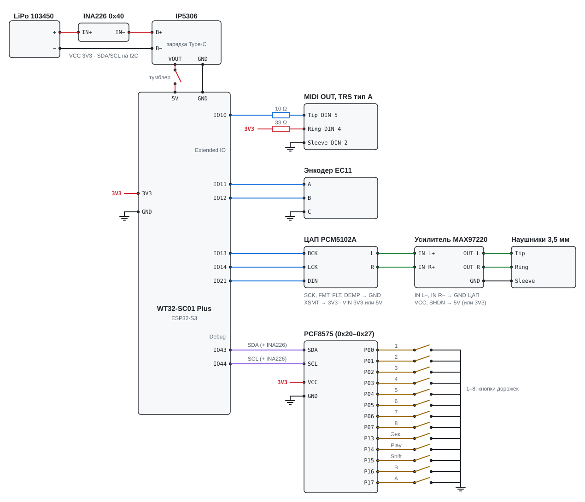

# Схема пайки трекера

Всё, что паяется к WT32-SC01 Plus: питание от аккумулятора, датчик заряда INA226, MIDI OUT, энкодер, расширитель PCF8575 с кнопкой энкодера, Play, Shift, A, B и восемью кнопками дорожек, ЦАП PCM5102A и усилитель для наушников MAX97220. Дисплей, тач и microSD уже разведены на плате.

English: [wiring.md](wiring.md)

## Принципиальная схема

<a href="img/wiring_ru.svg"></a>

```
LiPo 103450 + ── INA226 IN+ ─[шунт]─ INA226 IN− ── IP5306 B+   (Type-C модуля IP5306 — зарядка)
LiPo 103450 − ─────────────────────────────────── IP5306 B−
IP5306 VOUT ──[тумблер]── плата 5V             (VOUT/GND — площадки выпаянного USB-A)
IP5306 GND ──────────── плата GND              (общая земля)

WT32-SC01 Plus, разъём расширения (Extended IO)
  IO10 ──[10 Ом]─── MIDI Tip     (DIN 5)
  3V3  ──[33 Ом]─── MIDI Ring    (DIN 4)
  GND  ──────────── MIDI Sleeve  (DIN 2, экран)
  IO11 ──────────── энкодер A
  IO12 ──────────── энкодер B         энкодер C (средний) ── GND
  IO13 ──────────── ЦАП BCK
  IO14 ──────────── ЦАП LCK
  IO21 ──────────── ЦАП DIN

WT32-SC01 Plus, разъём Debug
  IO43 TXD0 ─────── PCF SDA
  IO44 RXD0 ─────── PCF SCL
  3V3 ───────────── PCF VCC
  GND ───────────── PCF GND
  (INA226 SDA / SCL / VCC / GND — параллельно PCF, на те же провода)

INA226 (адрес 0x40: A0, A1 на GND; ALE не нужен)
  IN+ ── LiPo +          IN− ── IP5306 B+
  VBS ── IN+             (если выведен: напряжение аккумулятора)
  VCC ── 3,3 В           GND ── GND

PCF8575 (адрес 0x20–0x27, находится сам; INT не нужен, A0–A2 свободны)
  P00 … P07 ── кнопка дорожки 1 … 8 ── GND
  P13 ──────── кнопка вала энкодера ── GND
  P14 ──────── Play ── GND
  P15 ──────── Shift ── GND
  P16 ──────── B ── GND
  P17 ──────── A ── GND

PCM5102A                                 MAX97220
  VIN ── 3,3 В или 5 В                     VCC ── плата 5V (или 3.3V);  SHDN ── VCC
  GND ── звезда ── плата GND               GND ── звезда
  SCK, FMT, FLT, DEMP ── GND (L)           IN L+ ── ЦАП L;   IN L− ── GND ЦАП
  XSMT ── 3,3 В (H)                        IN R+ ── ЦАП R;   IN R− ── GND ЦАП
  L / R ── линейный выход, на усилитель    OUT L / OUT R / GND ── гнездо Tip / Ring / Sleeve
```

*Каждый «GND» — провод на общий GND платы, каждое «3,3 В» — на вывод 3V3 платы. Входы A и B энкодера — с внутренней подтяжкой платы, у выводов PCF8575 своя слабая подтяжка, поэтому внешние резисторы к кнопкам и энкодеру не нужны. PCF8575 обязателен: без него не работают кнопка энкодера, Play, Shift, A, B и кнопки дорожек.*

## Таблица соединений

| Откуда                            | Куда                                | Примечание                                                  |
|-----------------------------------|-------------------------------------|-------------------------------------------------------------|
| **Питание** |                                     |                                                             |
| `LiPo + / −`                      | `IP5306 B+ / B−`                    | аккумулятор 103450 с платой защиты                          |
| `IP5306 VOUT`                     | `тумблер → плата 5V`                | VOUT и GND — площадки выпаянного USB-A модуля               |
| `IP5306 GND`                      | `плата GND`                         |                                                             |
| **Датчик заряда INA226** |                                     |                                                             |
| `LiPo +`                          | `INA IN+`                           | шунт стоит в разрыве плюсового провода аккумулятора         |
| `INA IN−`                         | `IP5306 B+`                         | ток «+» — разряд, «−» — зарядка                             |
| `INA IN+`                         | `INA VBS`                           | если вывод есть; меряется напряжение аккумулятора           |
| `плата 3V3`                       | `INA VCC`                           | только 3,3 В, не 5 В                                        |
| `плата GND`                       | `INA GND`                           | общая земля, она же минус аккумулятора                      |
| `Debug TXD0 (IO43) / RXD0 (IO44)` | `INA SDA / SCL`                     | параллельно PCF8575, адреса не пересекаются                 |
| `GND`                             | `INA A0, A1`                        | адрес 0x40; на большинстве модулей уже так                  |
| `—`                               | `INA ALE`                           | не подключать                                               |
| **MIDI OUT** |                                     |                                                             |
| `плата IO10`                      | `10 Ом → Tip`                       | MIDI DIN pin 5                                              |
| `плата 3V3`                       | `33 Ом → Ring`                      | MIDI DIN pin 4                                              |
| `плата GND`                       | `Sleeve`                            | MIDI DIN pin 2, экран                                       |
| **Энкодер EC11** |                                     |                                                             |
| `плата IO11 / IO12`               | `энкодер A / B`                     | крайние выводы тройки; крутится наоборот — поменять местами |
| `плата GND`                       | `энкодер C`                         | средний вывод тройки                                        |
| **ЦАП PCM5102A** |                                     |                                                             |
| `плата IO13 / IO14 / IO21`        | `ЦАП BCK / LCK / DIN`               | LCK также подписывают LRCK или WS                           |
| `плата 3V3 или 5V`                | `ЦАП VIN`                           | на модуле свой стабилизатор (LDO)                           |
| `плата GND`                       | `ЦАП GND`                           | звезда аудиоземли                                           |
| `GND`                             | `ЦАП SCK, FMT, FLT, DEMP`           | L: без MCLK (PLL от BCK), I2S, обычная задержка, де-эмфазис выкл. |
| `3,3 В`                           | `ЦАП XSMT`                          | H: звук включён                                             |
| **Усилитель для наушников MAX97220** |                                     |                                                             |
| `ЦАП L / R`                       | `усилитель IN L+ / IN R+`           | названия на шелкографии могут отличаться                    |
| `GND ЦАП`                         | `усилитель IN L− / IN R−`           | входы дифференциальные: «−» — на землю ЦАП                  |
| `плата 5V (или 3V3)`              | `усилитель VCC`                     | 5V — выход IP5306 после тумблера                            |
| `GND ЦАП`                         | `усилитель GND`                     | в звезду                                                    |
| `усилитель VCC`                   | `усилитель SHDN`                    | если выведен: VCC — работает                                |
| `усилитель OUT L / OUT R / GND`   | `гнездо Tip / Ring / Sleeve`        | DirectDrive: без выходных конденсаторов, Sleeve на GND — норма |
| **PCF8575 и кнопки (обязательно)** |                                     |                                                             |
| `плата 3V3`                       | `PCF VCC`                           | только 3,3 В, не 5 В                                        |
| `плата GND`                       | `PCF GND`                           | A0, A1, A2 не паять: прошивка сама найдёт адрес 0x20–0x27   |
| `Debug TXD0 (IO43) / RXD0 (IO44)` | `PCF SDA / SCL`                     | разъём Debug; 3V3 и GND можно взять с него же               |
| `—`                               | `PCF INT`                           | не подключать: модуль опрашивается каждые 5 мс              |
| `PCF P00 … P07`                   | `кнопка дорожки 1 … 8`              | второй вывод кнопки — на GND                                |
| `PCF P13`                         | `кнопка вала энкодера`              | второй вывод — на GND                                       |
| `PCF P14`                         | `кнопка Play`                       | второй вывод — на GND                                       |
| `PCF P15`                         | `кнопка Shift`                      | второй вывод — на GND                                       |
| `PCF P16 / P17`                   | `кнопка B / A`                      | второй вывод — на GND                                       |

Выводы задаются в `src/hw/pins.h`.

## Энкодер

Обычный механический EC11 с кнопкой (4 импульса на щелчок). Средний вывод из тройки A–C–B — на GND, крайние — на GPIO 11 и 12. Если при вращении значение идёт в обратную сторону, поменяйте местами A и B. Входы A и B — с внутренней подтяжкой (`INPUT_PULLUP`), внешние резисторы не нужны.

Желательно конденсаторы 10 нФ с выводов A и B энкодера на GND — меньше дребезга. Не обязательно: в прошивке есть аппаратный фильтр PCNT и программный дебаунс кнопок 5 мс.

## PCF8575 и кнопки

Кнопка энкодера, Play, Shift, A, B и 8 кнопок дорожек — на расширителе PCF8575 на I2C (порт 0; порт 1 занят тачем). У его выводов своя слабая подтяжка; кнопка замыкает вывод на GND. Если модуль не ответил при старте, прошивка запустится, но работать будут только тач и вращение энкодера.

- Раскладка задаётся в `src/hw/pins.h` (`kTrackBtnBit`, `kEncSwBit`, `kPlayBit`, `kShiftBit`, `kBtnABit`, `kBtnBBit`): если вывод испорчен, кнопку можно перенести на свободный вывод (номер 0–15 = P00–P07, P10–P17).
- Подтяжки SDA/SCL 4,7 кОм к 3,3 В обычно стоят на модуле — проверить.
- INT не нужен: прошивка опрашивает модуль каждые 5 мс. Найденный адрес печатается в USB-лог (`trackio: PCF8575 at 0x..`).
- Если площадки A0–A2 никуда не замкнуты и на модуле нет резисторов к GND, адрес висит в воздухе и может «гулять» — тогда замкнуть площадки на GND.
- GPIO 43/44 свободны, потому что лог и прошивка идут через родной USB (`ARDUINO_USB_CDC_ON_BOOT=1`). При старте загрузчик ESP32 печатает в TXD0 (GPIO 43) — модулю это не мешает.
- Безопасный старт (держать Shift при включении) читает Shift с расширителя до автозагрузки.

## Питание: важное

- Тумблер стоит после IP5306, поэтому аккумулятор заряжается через Type-C модуля и при выключенном трекере.
- **Прошивать только с выключенным тумблером.** Иначе на линии 5V встретятся два источника: USB компьютера и IP5306.
- Аккумулятор не подключать напрямую ни к 5V, ни к 3V3 платы — только через IP5306.
- Минусы аккумулятора, IP5306 и платы — общая земля; всё остальное на схеме садится на неё же.

## Датчик заряда INA226

INA226 стоит в плюсовом проводе аккумулятора, до IP5306, и меряет по I2C напряжение аккумулятора и ток через него со знаком: «+» — разряд, «−» — зарядка от Type-C. Тумблер — после IP5306, поэтому шунт в цепи всегда, а сам датчик питается от 3,3 В платы и при выключенном трекере обесточен. Аккумулятор он не разряжает.

- **Шунт.** На большинстве модулей стоит R100 (0,1 Ом), предел ±0,8 А. Трекер берёт от аккумулятора ~0,3 А — хватает. Зарядка IP5306 идёт током до ~2 А: показания упрутся в 0,8 А, но знак (идёт зарядка) виден. Шунт при этом греется до ~0,4 Вт — на модуле он должен быть в корпусе 2512. Чтобы мерить и ток зарядки, перепаять шунт на R010 (0,01 Ом, ±8 А).
- **Провода IN+ и IN−** — того же сечения, что провод аккумулятора: через них идёт весь ток, включая зарядный.
- **VBS.** Если на модуле есть вывод VBS (или VBUS) — на IN+, тогда меряется напряжение прямо на аккумуляторе. Если его нет, модуль меряет на IN− — разница на падение на шунте, для процента заряда некритично.
- **Адрес 0x40.** A0 и A1 на GND; на модулях они обычно уже притянуты резисторами. PCF8575 — 0x20–0x27, не пересекаются.
- **Подтяжки I2C.** У модуля свои 10 кОм на SDA и SCL, вместе с подтяжками PCF8575 — нормально.

## MIDI-гнездо

- Распиновка TRS **тип A**: Tip = pin 5, Ring = pin 4. Для устройств с типом B (некоторые Arturia, Novation) — переходник A→B или поменять местами провода на Tip и Ring.
- Для 5-контактного DIN: те же резисторы на pin 5 и pin 4, GND на pin 2.
- UART без инверсии, 31250 бод, 3,3 В. Опционально можно поставить буфер 74HC14 (два инвертора последовательно) между GPIO10 и резистором 10 Ом.
- MIDI-входа нет: устройство всегда ведущее, отправляет clock, Start/Stop/Continue.

## ЦАП и наушники

```
плата IO13 ─── ЦАП BCK
плата IO14 ─── ЦАП LCK
плата IO21 ─── ЦАП DIN

ЦАП L ──────── усил. IN L+          усил. OUT L ── Tip    (левый)
ЦАП R ──────── усил. IN R+          усил. OUT R ── Ring   (правый)
ЦАП GND ─┬──── усил. IN L−          усил. GND ──── Sleeve
         ├──── усил. IN R−
         ├──── усил. GND
         └──── плата GND            (звезда у GND ЦАП)

ЦАП SCK, FMT, FLT, DEMP ── GND     ЦАП XSMT ── 3,3 В     ЦАП VIN ── 3,3 В или 5 В
усил. VCC, усил. SHDN ── плата 5V (или 3V3)
```

*Встроенный усилитель NS4168 и разъём SPK платы (GPIO 35/36/37) не используются. Сигнал стерео, левый канал в L, правый в R (дорожки в центре звучат в обоих одинаково): 32 кГц, 16-битные отсчёты в 32-битных слотах (BCK = 64 fs).*

- **Настройка ЦАП.** SCK на GND (без MCLK: PLL берёт такт с BCK), FMT = L (I2S), FLT = L (обычная задержка), DEMP = L (де-эмфазис выключен), XSMT = H (звук включён). На фиолетовых модулях GY-PCM5102 это площадки-перемычки на обороте — сверьтесь с шелкографией своего модуля.
- **Линейный выход.** L / R ЦАП дают 2,1 В RMS на полной шкале, относительно земли. В отличие от прежнего выхода SPK, их можно подавать в микшер, звуковую карту или активные колонки — с ЦАП до усилителя или с выхода усилителя для наушников.
- **Входы усилителя** дифференциальные: L+ / R+ — на L / R ЦАП, L− / R− — на GND ЦАП (AGND). Названия выводов на шелкографии модуля могут отличаться.
- **Выходы DirectDrive** — относительно земли, без разделительных конденсаторов: Sleeve гнезда наушников — на GND, гнездо может касаться корпуса.
- **Уровень.** 2,1 В RMS с ЦАП — больше, чем MAX97220 может выдать: если звук хрипит или слишком громкий, убавьте Phones (FILE → SYSTEM) или поставьте делитель / потенциометр между ЦАП и усилителем.
- **Земля.** Короткие провода аудиоземли и одна точка-звезда у GND ЦАП: туда сходятся земли ЦАП, усилителя и гнезда, оттуда один провод — на GND платы. Иначе в наушниках может пищать повышающий преобразователь IP5306.
- Первое включение — с громкостью Phones (FILE → SYSTEM) на минимуме и не надевая наушники.

## Встроенная периферия (для справки)

| Узел | Пины |
|---|---|
| microSD (SPI) | CS 41, MOSI 40, CLK 39, MISO 38 |
| Тач FT6336U (I2C) | SDA 6, SCL 5, INT 7, RST 4 (общий с LCD) |
| Дисплей ST7796 | шина 8080, 8 бит (внутренняя разводка платы) |

GPIO 1, 2, 42 идут на встроенный приёмопередатчик RS485, на разъём выведены только линии A/B. GPIO 35, 36, 37 идут на встроенный усилитель NS4168 и разъём SPK; они не используются: динамик снят, звук идёт на внешний ЦАП на GPIO 13/14/21. GPIO 43/44 (разъём Debug) заняты PCF8575 и INA226.

## Перед включением


1.  Прозвонить: 5V и GND платы не закорочены; тумблер в положении «выкл.» размыкает VOUT.
2.  ЦАП: на XSMT 3,3 В; SCK, FMT, FLT, DEMP звонятся с GND; GPIO 13, 14, 21 не закорочены между собой, на GND и на 3,3 В. Усилитель: IN L− и IN R− звонятся с GND ЦАП, SHDN (если выведен) — с VCC.
3.  A0, A1, A2 на модуле можно не трогать. Если модуль то находится, то нет (адрес «плавает»), замкнуть все три площадки на GND.
4.  Посмотреть, есть ли на модуле резисторы подтяжки SDA и SCL (обычно 4,7–10 кОм к VCC). Если нет — поставить 4,7 кОм от каждой линии на 3,3 В.
5.  Питать модуль только от 3,3 В, не от 5 В: иначе на GPIO платы придёт 5 В.
6.  Прозвонить, что TXD0 и RXD0 не закорочены между собой и на GND. GPIO 1, 2, 42 не трогать: они заняты встроенным RS485.
7.  INA226: IN+ звонится с плюсом аккумулятора, IN− — с B+ IP5306; между IN+ и IN− — сопротивление шунта (доли ома), не обрыв. VCC модуля — на 3,3 В, не на 5 В.
8.  После прошивки открыть монитор порта: строка `trackio: PCF8575 not found` значит, что модуль не отвечает — проверить SDA/SCL и питание (без модуля не работают и кнопка энкодера, Play, Shift, A и B); `trackio: PCF8575 at 0x..` — найден.
